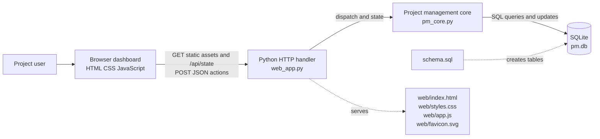
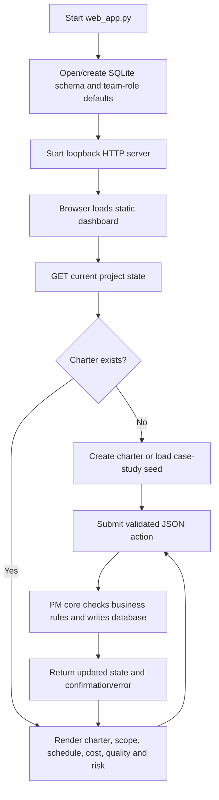

# Chapter 4: System Architecture and Design

## Architecture summary

The application uses a three-part local architecture:

1. **Browser presentation:** `web/index.html`, `web/styles.css`, and `web/app.js` render a single-page dashboard with client-side view switching and forms.
2. **Python HTTP/API layer:** `web_app.py` serves an allow-listed set of static files, exposes `GET /api/state`, and routes JSON `POST /api/{action}` operations to business logic.
3. **Business/data layer:** `pm_core.py` owns validation, project rules, calculations, and SQLite queries. `schema.sql` creates the relational schema; the selected database is `pm.db`.

The browser and server use same-origin HTTP on the local loopback interface. The API returns JSON, and the browser refreshes its project state after mutations. The server uses `ThreadingHTTPServer`; a per-handler `RLock` guards state reads and dispatches.

## System architecture diagram

## Application workflow

## API surface

The API is a local application interface, not a healthcare data API. It has no versioned OpenAPI document. The actual actions are routed from `_dispatch()` in `web_app.py`.

| Method/path | Purpose |
|---|---|
| `GET /api/state` | Read project, dashboard, requirements, WBS, changes, activities, roles, milestones, defects, inspections, risks, and reports |
| `POST /api/sample` | Load sample case study when no charter exists |
| `POST /api/create-charter`, `/api/update-charter`, `/api/update-plan`, `/api/set-status` | Create/update charter, plan, lifecycle status |
| `POST /api/add-milestone`, `/api/achieve-milestone`, `/api/close-project` | Manage milestones and closure |
| `POST /api/add-requirement`, `/api/update-requirement`, `/api/decide-requirement` | Manage requirement records and decisions |
| `POST /api/add-wbs` | Add a WBS item with scope-gating validation |
| `POST /api/submit-change`, `/api/decide-change` | Submit/decide change requests |
| `POST /api/add-member` | Add a descriptive project team-role record |
| `POST /api/add-activity`, `/api/update-activity`, `/api/set-dependencies` | Schedule activities and update actuals/dependencies |
| `POST /api/add-defect`, `/api/update-defect` | Record and resolve defects |
| `POST /api/add-quality-check`, `/api/record-quality` | Define and record inspections |
| `POST /api/add-risk`, `/api/update-risk` | Register risks and update status |
| `POST /api/export` | Return text summary of scope and charter |
| `GET /`, `/index.html`, `/styles.css`, `/app.js`, `/favicon.svg` | Static dashboard assets |

## Data flow

1. A user action builds a JSON request in `web/app.js`.
2. `web_app.py` parses the body and resolves the action name.
3. `_dispatch()` invokes a `PM` method.
4. The method validates input and accesses the SQLite database.
5. The handler gathers updated state and returns JSON; validation/business errors are returned as HTTP 400, other unexpected exceptions as HTTP 500.
6. The browser replaces its in-memory state and re-renders the view.

## Design and operational boundaries

- The application has no separate deployment frontend/backend service; UI assets are served by the Python process.
- The `PM` class initializes schema and default team roles on opening the DB. `PM.run()` commits each statement; not all multi-step operations are grouped into transactions.
- Static path selection is allow-listed. SQL data values are generally parameterized.
- The app has no background job queue, external service adapter, authentication service, user directory, or role-permission policy.
- Inferred components such as a future patient portal, AI inference service, billing gateway, or clinical record system must not be added to architecture diagrams as existing components.

## Design concerns for future work

Review schedule forecast dependency handling and edge cases; use explicit transaction boundaries for multi-table workflows; formalize API payload/schema validation; enable database foreign-key checks; introduce authentication/authorization and request-origin protection if any remote/shared access is intended. These are recommendations, not changes made by this report.
