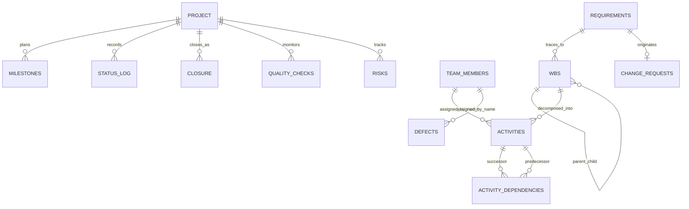

# Chapter 4 support: Database Analysis

## Overview

SQLite is the only persistence layer identified. `schema.sql` defines 13 application tables. `project.id` is constrained to one row (`id = 1`); the remaining tables hold project history and management records. The SQL schema declares primary keys, selected uniqueness/enum/range checks, and foreign-key relationships. `pm_core.PM` executes the schema during initialization and supplies default team-role records when the team table is empty.

## Tables and purpose

| Table | Purpose and key attributes |
|---|---|
| `project` | Single charter and plan: objectives, stakeholder text, scope in/out, budget, deadline, start date, status, plan fields |
| `milestones` | Named due-week checkpoints, owner text, Pending/Achieved |
| `status_log` | Status/event notes with database timestamp |
| `closure` | Closure summary and lessons |
| `requirements` | Title, description, priority, Proposed/Approved/Rejected, Original/Change Request source |
| `wbs` | Hierarchical deliverables with parent, unique dotted code, requirement link |
| `change_requests` | Justification, linked requirement, cost/week impacts, decision fields and before/after baseline values |
| `team_members` | Unique case-insensitive name and descriptive role |
| `activities` | Owner, duration, estimated/actual cost, completion, requested/calculated weeks, optional WBS link |
| `activity_dependencies` | Activity-to-predecessor many-to-many relation; self-dependency check |
| `defects` | Title, severity, owner text, status, creation timestamp |
| `quality_checks` | Unique deliverable, criterion, test result, notes, inspection timestamp |
| `risks` | Description, likelihood/impact, preventive/corrective actions, status |

## Entity relationship diagram

The `TEAM_MEMBERS` links shown by name and the `PROJECT` links to management tables describe logical ownership; the schema does **not** declare those foreign keys. Only explicit `REFERENCES` clauses in `schema.sql` are enforceable relationships when SQLite foreign-key enforcement is enabled.

## Integrity and design observations

1. Primary keys and many enumerated states are constrained in schema; unique names are case-insensitive for team members, activities, and quality-check deliverables.
2. The core applies additional checks (for example assigned team membership, approved WBS scope, and relationship existence).
3. `PRAGMA foreign_keys=ON` was not found in the reviewed source. SQLite does not enforce declared foreign keys by default in a typical connection unless enabled; code paths should enable it explicitly and test it.
4. Several important relationships are plain text (`assigned_to`) rather than IDs/foreign keys. Renaming a team member would not have referential integrity support.
5. `activity_dependencies` declares `ON DELETE CASCADE`, but its effect depends on foreign-key enforcement.
6. `project` has a single-row constraint but milestones, status log, and closure tables can contain multiple entries; business logic currently governs closure flow.
7. There is no migration/version table, schema migration process, or documented backup strategy.
8. The `activities`/defects/risks/quality tables are project-management records; there are no patient identifiers, encounters, appointment slots, clinical notes, prescriptions, or invoices.

## Read-only database snapshot findings (31 October 2026)

The three database files are not identical and should not be treated as one authoritative historical project record.

| Database | Key inspected state | Interpretation |
|---|---|---|
| `pm.db` | One project, 7 requirements, 8 WBS rows, 2 approved changes, 7 activities, 2 defects, 3 inspections, 2 risks; status `Planning`; no milestone records | Existing case-study/test-like snapshot; not consistent with canonical seed milestones/status |
| `demo.db` | One project, 5 milestones, status `Closed`; no requirements, activities, defects, risks, or quality checks | Separate demonstration snapshot |
| `demo2.db` | One project, 9 requirements, 22 WBS rows, 3 change requests; status `Initiating`; no activities or milestones | Separate scope demonstration snapshot |

The SQL seed `sample_data.sql` gives project status `Executing` and five milestones, while the runtime `_sample_project()` in `web_app.py` uses a different set of milestone/activity details. The current `pm.db` has no milestones and reports `Planning`. This divergence is a data provenance issue: use a freshly generated, approved baseline before presenting any snapshot as authoritative.

No database file was modified during this analysis.
